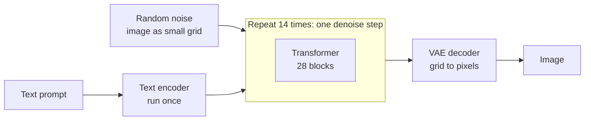
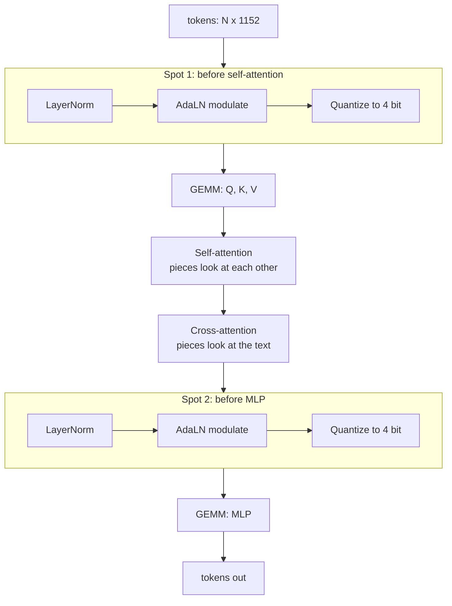
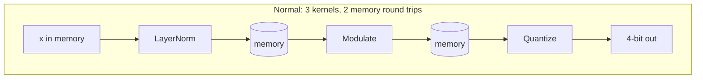
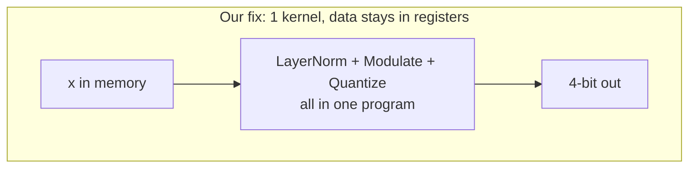
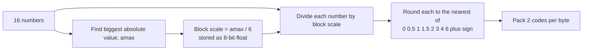
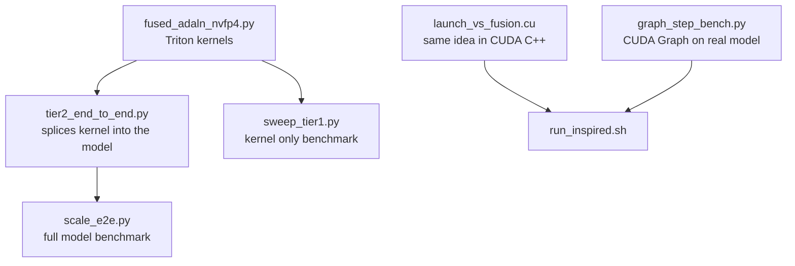
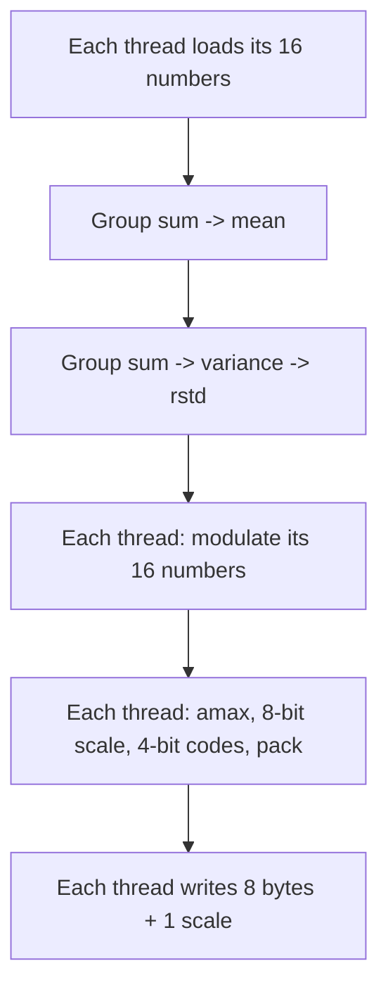
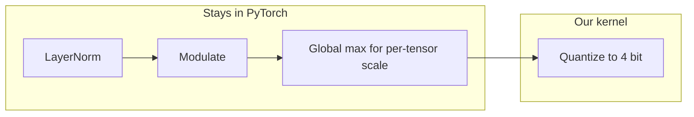

# Code primer (simple version)

Part A explains the problem and the model. Part B explains the code.
Read Part A first. If Part A is clear, Part B is easy.

---

# Part A. The architecture we are working on

## A1. The model in one picture

PixArt-Sigma makes an image from text. It starts from random noise and cleans it up
step by step. We run about 14 cleaning steps.



- The transformer is the heavy part. It runs 14 times.
- We skip the text encoder in the tests. We use random numbers instead (speed does not depend on them).
- The transformer has **28 identical blocks**.

## A2. One block, and where the problem is

The image is cut into small pieces called **tokens**. 256px image = 256 tokens.
512px = 1024 tokens. 1024px = 4096 tokens. Each token is a list of 1152 numbers.



Two plain words:
- **GEMM** = a big matrix multiplication. This is most of the math.
- **Quantize** = store each number in 4 bits instead of 16. The GEMM runs faster on 4-bit numbers.

The problem zone is the 3 small steps before each GEMM: **LayerNorm, AdaLN modulate, Quantize**.
They happen 2 times per block, so **56 times per denoise step** (28 x 2).

## A3. What goes wrong in the problem zone

Each small step is its own GPU program (a "kernel"). Each one reads its input from
GPU memory and writes its output back.





Two costs in the normal way:
1. **Memory trips.** The middle results are big (16-bit or 32-bit per number). Writing them out and reading them back wastes time.
2. **Launch cost.** The CPU must start each kernel (about 5 microseconds each). Eager PyTorch starts about 50 small kernels for this boundary.

Fusion removes both: one kernel, and the middle data never leaves the chip.

## A4. Why the gain gets smaller for big images

The problem zone grows in step with the number of tokens. But the other parts grow faster:

| Part | Grows with tokens as |
|---|---|
| Red zone (our kernel) | N (linear) |
| GEMMs (QKV, MLP) | N (linear) |
| Attention scores | N x N (square) |

At 256 tokens the problem zone is a visible slice. At 4096 tokens attention dominates, so the slice
is small. Our fix is the same size, but the whole step is much bigger. This is the main
question the 2-hour test answers: **how much does the full image gain at each size?**

## A5. The 4-bit format (NVFP4) in 30 seconds

The 1152 numbers of a token are cut into **72 blocks of 16 numbers**. For each block:



Output per token: 576 bytes of codes + 72 bytes of block scales.
Both of our kernels must produce exactly these bytes. If rounding is off by one step, the bytes differ.

---

# Part B. The code, easy version

## B1. Which file does what



## B2. Triton vs CUDA: the one idea you need

| | Triton (Python) | CUDA C++ |
|---|---|---|
| You write | the work for **one row** | the work for **one thread** |
| Who picks threads | Triton | you |
| Style | vectors: "load 16 numbers, take max" | loops: "this thread owns 16 numbers" |
| Why we have both | fast to write, used in the model | shows what Triton hides, and lets us test CUDA Graphs |

Both do the same 5 jobs. Think of one row = one token = 1152 numbers:

1. **Load** the row.
2. **LayerNorm:** subtract the average, divide by the spread.
3. **Modulate:** `x * (1 + scale) + shift`. The scale and shift come from the timestep.
4. **Per block of 16:** find amax, make the 8-bit scale.
5. **Encode:** round to 4-bit codes and pack 2 per byte.

## B3. The Triton kernel, step by step

File: `fused_adaln_nvfp4.py`, function `_fused_ln_adaln_nvfp4_kernel`.

```text
row = program_id(0)                 <- "I am row number row"
tile = load row as 72 blocks x 16   <- one trip to memory
mean, variance = sum over the tile  <- LayerNorm statistics
x_mod = (x-mean)*rstd*(1+scale)+shift   <- modulate, round to bf16
amax = max |x_mod| per block        <- one number per 16
scale8 = amax/6 -> 8-bit float
codes = round(x_mod / scale8) to the 8 allowed values
bytes = low nibble + high nibble * 16   <- pack 2 codes
store bytes and scale8              <- one trip to memory
```

The 3 Triton kernels in the file:

| Kernel | Does | In the model run? |
|---|---|---|
| `_fused_ln_adaln_nvfp4_kernel` | LayerNorm + modulate + quantize | **No.** Kernel tests only. |
| `_fused_modulate_nvfp4_kernel` | modulate + quantize | No. |
| `_fused_quant2lvl_kernel` | quantize only (with a per-tensor scale) | **Yes.** This is what the model run uses. |

Two small facts:
- It uses exact division (`div_rn`). Plain `/` in Triton is a little inexact and changed about 1% of the codes.
- Triton needs sizes that are powers of 2, so 72 blocks are padded to 128. This wastes some work but does not change the result.

## B4. The CUDA kernel, step by step

File: `external_tests_inspired/launch_vs_fusion.cu`.

Layout: **one thread block per row, 96 threads.** Threads 0 to 71 each own one block of 16 numbers.
Threads 72 to 95 do nothing, but they must join the group sums.



Functions in the file:

| Name | Plain meaning |
|---|---|
| `block_sum` | "All 96 threads add their numbers together." Needs every thread to take part. |
| `load_and_stats` | Load 16 numbers, get mean and rstd for the row. |
| `modulate` | `x*(1+scale)+shift`, rounded to bf16. |
| `e2m1` | Round a number to the nearest of the 8 allowed 4-bit values. |
| `quant16` | The whole 16-number job: amax, scale, codes, packed bytes. |
| `fused_kernel` | All of the above in one kernel. |
| `k1_layernorm`, `k2_modulate`, `k3_quant` | The same job in 3 kernels. K1 and K2 write big tensors to memory. |
| `time_step` | Runs 56 calls, either one by one or as one CUDA Graph. |

Why fused and unfused give the same bytes: every float operation is written as `__fmul_rn`,
`__fadd_rn`, and so on. These tell the compiler not to re-order or merge operations.

**What the CUDA test measures.** Four timings per size:

| | Launched one by one | Launched as one CUDA Graph |
|---|---|---|
| 3 kernels | unfused eager | unfused graph |
| 1 kernel | fused eager | fused graph |

- Fused vs unfused = the gain from **fusion** (fewer memory trips).
- Graph vs eager = the gain from **less launch cost**.

Reported result: fusion gave 2.9x to 5.0x. The graph gave about 1.0x. So in a direct CUDA
chain, launch cost was not the limit on this server.

## B5. What the model run really fuses (read this)



In the model run only the **Quantize** step is our kernel. This matches the earlier tests, but it
is a smaller slice than the 10 to 40x kernel numbers suggest.

It also only handles rows of width 1152. Per block, 9 quantize calls are fused. One is not:

| Layer | Input width | Fused? |
|---|---|---|
| Self-attention Q, K, V and output | 1152 | yes |
| Cross-attention Q, K, V and output | 1152 | yes |
| MLP first layer | 1152 | yes |
| **MLP second layer** | **4608** | **no, falls back** |

So **a large fallback count is normal** (about 1 call in 10). Over 14 steps the old log shows
3584 fused and 420 fallback calls. The check that matters: **`fused_calls` must be above 0** in fused mode.

One idea not used yet: Q, K and V quantize the same input three times. Quantizing once would save work.

## B6. Check list before you run

| Check | What you should see |
|---|---|
| `pixi run smoke` | One JSON line. `fused_calls` above 0. `fallback_calls` in the hundreds is fine. |
| `images.log` | Mean difference 0.0 means stock and fused images are identical. |
| Step time at 256, 512, 1024 | Fused vs stock vs bf16. This is the real result. |
| `nsys` split | If GEMM + attention is above 70% at 1024px, our slice is small. That is expected. |
| `graph_step_bench.py` | If CPU launch ms is above GPU ms, the step is launch-bound and graphs help. |
| A few differing bytes at large sizes | Normal. It is a rounding tie in float addition order. Not a bug. |

Things that are limits, not bugs:
- Image content is meaningless (random text numbers). Compare stock vs fused only.
- The full LayerNorm + quantize kernel is not in the model run.
- ncu reports cold-cache memory traffic. Real runs may see less.
- In the CUDA test, small sizes fit in the L2 cache, so the unfused memory cost looks smaller than it really is.
