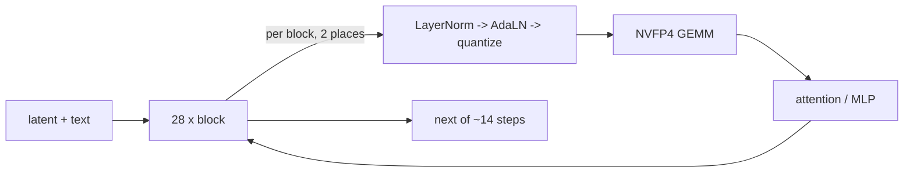

# RTX 5000 Pro runs: plain-language guide

This guide explains what we test in the 2-hour server window, why, how to run it,
and how to read the results. Read section 1 and 2 first. Use section 5 during the session.

## 1. The idea in one page

**Model.** PixArt-Sigma is a diffusion transformer (DiT). It makes an image by
repeating one "denoise step" about 14 times. One step runs 28 identical blocks.

**Quantization.** NVFP4 stores numbers in 4 bits instead of 16. The matrix
multiplies (GEMMs) run faster on Blackwell tensor cores. Before each GEMM the
activations must be converted to 4 bits. This conversion is the "quant" step.

**What we built.** Before each quantized GEMM the model does three small GPU jobs:
LayerNorm, AdaLN modulate, quantize. We wrote one kernel that does all three.
It keeps data in registers, so the large 16-bit middle tensor never goes to memory.

**What we measured so far (RTX 5060, 256px).** The boundary itself is 14x faster.
The whole image is only about 1.3x faster. The rest of the time is GEMMs,
attention, and Python/launch overhead.

**What the server must answer.** Does this still help at 512px and 1024px?
Is the comparison fair? What is the real bottleneck at each size?



## 2. Words you need

| Term | Meaning |
|---|---|
| Token N | Image pieces the transformer sees. N = (size/16)^2: 256px=256, 512px=1024, 1024px=4096. |
| Kernel | One program on the GPU. |
| Kernel launch | The CPU telling the GPU to start a kernel. It costs about 5 microseconds. |
| Launch-bound | The GPU waits for the CPU to launch tiny kernels. Fusion and CUDA Graphs help here. |
| Memory-bound | The kernel waits for DRAM. Fusion helps by removing a memory round trip. |
| Compute-bound | The kernel waits for math units. Fusion does not help. GEMMs and big attention are here. |
| CUDA Graph | Record many launches once, replay them with one CPU call. Removes launch cost. |
| CFG | Classifier-free guidance. Each step runs the model on 2 inputs, so batch 1 means 2 rows of work. |
| ncu | Nsight Compute. Deep detail on one kernel (time, DRAM bytes). Slow. |
| nsys | Nsight Systems. Timeline of all kernels. Shows where time goes. |
| Amdahl's law | A speedup of one part is limited by that part's share of total time. |
| stock / fused | stock = torchao's normal NVFP4 path. fused = our kernel spliced in. |

## 3. What each experiment tests

| # | Script | Question | Time |
|---|---|---|---|
| 1 | `sweep_tier1.py` | How fast is the boundary at each size? Is the output the same bytes? Does `torch.compile` already fix it? | 5 min |
| 2 | `ncu_sweep.sh` | How much GPU time and DRAM traffic does the boundary use, fused vs unfused? | 10 min |
| 3 | `scale_e2e.py` | Full model per step: bf16 vs NVFP4 stock vs NVFP4 fused, at 256/512/1024. | 40 min |
| 4 | nsys phase | What share of GPU time is GEMM, attention, norm-quant? | 25 min |
| 5 | `external_tests_inspired/` | Is the win from fusion or from removing launch cost? Do CUDA Graphs give more? | 15 min |
| 6 | `run_all.sh stretch` | Batch 4, and `torch.compile` baseline. Optional. | 15 min |

Experiment 5 comes from the GraspGenX PR #7. That PR got 30-40x mostly by
replaying the whole forward pass as one CUDA Graph and fusing small kernels.
Our model has real compute (GEMMs, attention), so we expect smaller gains.

## 4. Setup (do once, before the clock starts)

```bash
git clone <your repo> && cd <repo>/rtx_5000_runs
pixi install --locked        # builds the env (torch 2.15 nightly cu130, torchao, triton, diffusers)
pixi run gpucheck            # must print the RTX 5000 Pro and capability (12, 0)
pixi run download            # ~8 GB: 3 PixArt transformers + VAE. No text encoder.
ncu --version; nsys --version
```

Notes:
- No pre-made NVFP4 PixArt checkpoint exists. torchao converts the bf16 weights to NVFP4 when the model loads.
- Text embeddings are random numbers, so no T5 download. Speed and stock-vs-fused equality do not depend on them.
- Images from these runs are not meaningful pictures. Compare stock vs fused only.
- PyTorch uses its own CUDA libraries (cu130). The server's `nvcc 13.3` is used only for `launch_vs_fusion.cu`.

## 5. Run order during the 2 hours

```bash
pixi run smoke                         # 1-2 min: proves the whole path works. Fix problems now.
bash run_all.sh tier1 ncu              # experiments 1-2
bash run_all.sh e2e                    # experiment 3
bash run_all.sh nsys                   # experiment 4
bash external_tests_inspired/run_inspired.sh   # experiment 5
bash run_all.sh stretch                # only if time is left
python make_report.py                  # writes results/REPORT.md
tar czf results.tgz results            # copy off the server
```

If a step fails, do not debug for more than 5 minutes. Skip it and note the error text.
Logs are in `results/`. Every run is a separate process, so runs do not contaminate each other.

## 6. How to read the results

Open `results/REPORT.md`. Use this table to decide.

| You see | It means | Say in the report |
|---|---|---|
| fused vs stock about 1.2-1.4x at 256px, falling to about 1.05x at 1024px | Real win but shrinks as GEMM/attention grow (Amdahl). | Fusion helps most at small, launch-bound sizes. |
| nsys: GEMM + attention above 70% at 1024px | Norm-quant is a small slice. | Fusion cannot give more than the slice. |
| `torch.compile` stock is close to fused | The eager baseline was weak. | Our kernel's value is smaller against a compiled baseline. State this honestly. |
| CUDA Graph speedup is large at 256px, small at 1024px | The 256px win is launch overhead. | Graphs plus fusion is the best combination for small images. |
| stock NVFP4 slower than bf16 at 256px | Quantization overhead beats GEMM savings at small sizes. | NVFP4 pays off only above some size. |
| a few differing bytes at 1024px | Float reduction order at a rounding tie. | Output is equal within a handful of bytes per million. |
| `images.log` shows mean diff 0.0 | Stock and fused images are identical. | Quality-neutral. |

## 7. Known limits (be upfront about these)

- The fused kernel is validated only for hidden size 1152. Other sizes fall back to the stock path.
- End-to-end uses the quant-only fused kernel. The full LayerNorm+AdaLN+quant kernel is proven at kernel level only.
- Timing is GPU time from CUDA events. Wall time also includes Python and the scheduler.
- Numbers from the RTX 5060 and the RTX 5000 Pro are not comparable. Compare within one machine.
- Model checkpoints differ by size (256, 512-MS, 1024-MS). Speed does not depend on the weights.

## 8. File map

| File | Role |
|---|---|
| `pixi.toml`, `pixi.lock` | Exact environment. |
| `download_models.py` | Fetches the checkpoints. |
| `fused_adaln_nvfp4.py` | Our Triton kernels. |
| `tier2_end_to_end.py` | Patch that splices the fused kernel into torchao. |
| `scale_e2e.py` | Full-model benchmark, one mode per process. |
| `sweep_tier1.py`, `profile_kernel.py` | Boundary microbenchmarks. |
| `ncu_sweep.sh`, `summarize_ncu.py` | ncu runs and summary. |
| `classify_nsys.py` | Buckets nsys kernels into GEMM / attention / norm-quant. |
| `compare_images.py` | Stock vs fused image difference. |
| `external_tests_inspired/` | CUDA C++ and CUDA Graph tests from the GraspGenX idea. |
| `make_report.py` | Builds `results/REPORT.md`. |
