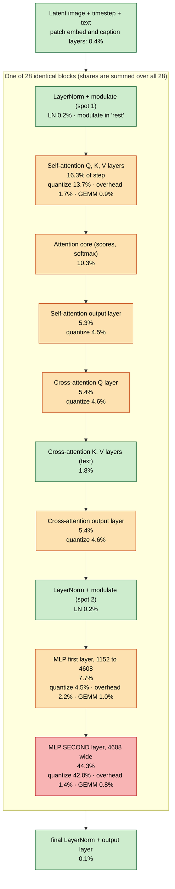
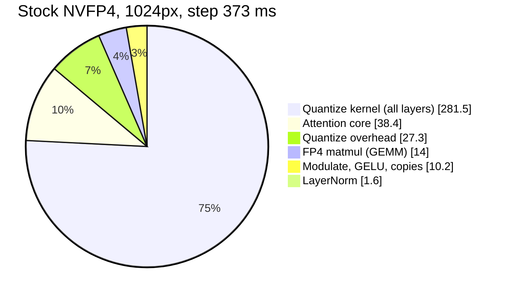
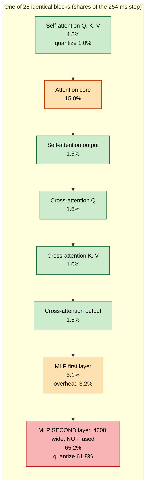
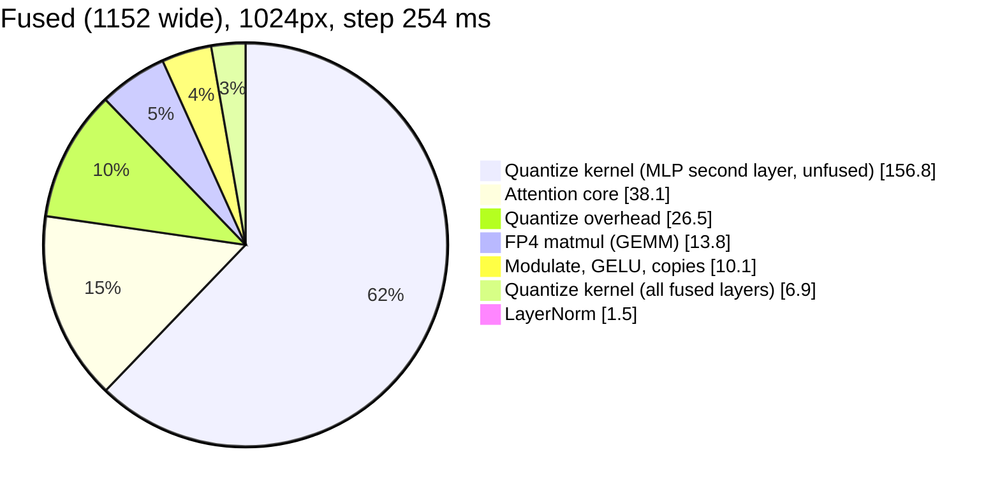
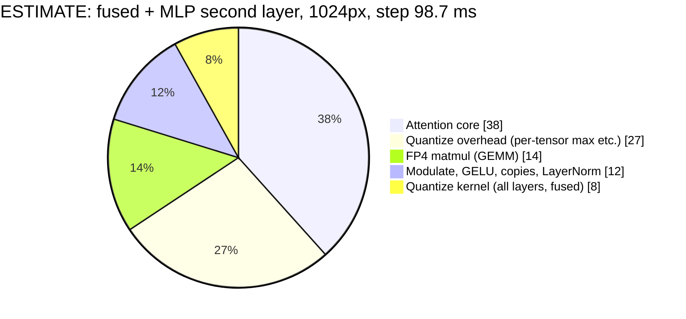

# Where the time goes in one PixArt-Sigma denoise step (measured)

All numbers: RTX PRO 5000, clean GPU, 2026-10-25, one denoise step (the transformer forward, batch 1 with guidance),
from `breakdown_step.py` (`results/breakdown.jsonl`). Percentages are shares of the whole step.

- **Quantize** = converting the bf16 input of a layer to 4-bit FP4 (the part we fuse).
- **Overhead** = the rest of the quantization work around it (per-tensor max and similar).
- **GEMM** = the FP4 matrix multiply itself.

Colors: red = above 20% of the step, orange = 5% to 20%, green = below 5%.

## 1. NVFP4 stock, 1024px (step 373 ms)

Where the 373 ms goes, by kind of work:

## 2. NVFP4 fused (1152-wide layers only), 1024px (step 254 ms)

The fused quantize kernel took the first eight layer types from 16 to 51 ms down to under 3 ms each.
The MLP second layer was not covered, so it is now the whole story.

## 3. After also fusing the MLP second layer (`fused_wide`), 1024px: step 98.7 ms

Only the step time was measured (bf16 is 103.1 ms). The split below is an **estimate**, made by subtracting the measured
parts from the earlier run. It has not been measured. Run `bash run_breakdown_only.sh` (now includes `fused_wide`) to measure it.

## 4. The same split at all image sizes (measured)

| Image | Mode | Step ms | Quantize | Overhead | GEMM | Attention core | LayerNorm | Rest |
|---|---|---|---|---|---|---|---|---|
| 256px | bf16 | 15.2 | 0% | 0% | 50% | 17% | 5% | 29% |
| 256px | stock | 118.8 | **57%** | 23% | 8% | 2% | 1% | 8% |
| 256px | fused | 72.0 | 33% | 36% | 12% | 4% | 2% | 14% |
| 512px | bf16 | 24.5 | 0% | 0% | 64% | 22% | 2% | 12% |
| 512px | stock | 119.5 | **61%** | 18% | 9% | 5% | 1% | 6% |
| 512px | fused | 72.0 | 40% | 27% | 13% | 9% | 1% | 10% |
| 1024px | bf16 | 104.4 | 0% | 0% | 48% | 40% | 2% | 10% |
| 1024px | stock | 373.0 | **76%** | 7% | 4% | 10% | 0% | 3% |
| 1024px | fused | 253.7 | 64% | 10% | 5% | 15% | 1% | 4% |

("Rest" includes the modulate step, GELU, residual adds and copies.)

## 5. Takeaways

1. Quantization is 57% to 76% of the stock step, plus 7% to 23% overhead. The FP4 matmul is only 4% to 9%.
2. LayerNorm plus modulate cost 1% to 3% of the step. They are not where the unfused cost sits.
3. At 1024px the MLP second layer alone is 44% of the stock step and 65% of the 1152-only fused step. Fusing it took the step from 250.8 ms to 98.7 ms.
4. At 256px and 512px the step is limited by the CPU launching kernels (CUDA Graph gave 3.2x and 1.3x), so percentages there include idle time.
