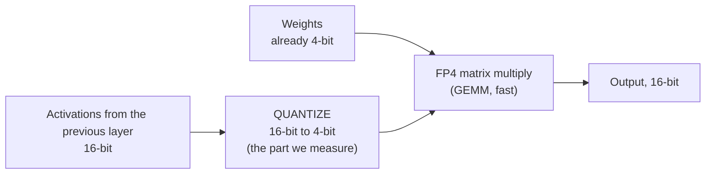

# What "quantize" means here, and what the 156.8 ms is

## 1. The one-sentence version

Before every big matrix multiply, the model shrinks its input numbers from 16 bits to 4 bits.
That shrinking step is "quantize". We measure how long it takes. In the MLP second layer it takes 156.8 ms per denoise step at 1024px, and our fast kernel does not cover that layer.

## 2. Why shrinking is needed when the model is "already NVFP4"

A matrix multiply needs two inputs: the **weights** and the **activations** (the data flowing through the model).

| Input | State | Who shrinks it, and when |
|---|---|---|
| Weights | Stored in 4 bits | Once, when the model loads. Free at run time. |
| Activations | Arrive as 16-bit (bf16) from the previous operation | **Every layer, every step, every image.** This is the quantize step. |

The fast FP4 matrix multiply only accepts 4-bit numbers on both sides. So the 16-bit activations must be converted first.
The activations change every step, so this cannot be done ahead of time.

## 3. What quantize does, with real numbers

NVFP4 can only store 8 sizes: **0, 0.5, 1, 1.5, 2, 3, 4, 6** (plus a sign). To fit arbitrary numbers into that, the numbers
are cut into groups of 16, and each group gets its own scale.

Example with 4 of the 16 numbers in one group: `0.9, -2.7, 0.11, 5.4`

| Step | What happens | Result |
|---|---|---|
| 1 | Find the biggest absolute value in the group | 5.4 |
| 2 | Scale = biggest / 6 (6 is the largest storable size) | 0.9 |
| 3 | Divide every number by the scale | 1.0, -3.0, 0.12, 6.0 |
| 4 | Round each to the nearest storable size | 1, -3, 0, 6 |
| 5 | Store the 4-bit codes, and store the scale (8 bits) per group | done |
| later | To use the number again: code x scale | 0.9, -2.7, 0, 5.4 |

The value 0.11 became 0. That is the rounding loss. The big values survived exactly.
There is also one extra scale for the whole tensor. It needs a maximum over the entire tensor first, before any group can be processed.

So one quantize call does, for every number: read it, find group maxima, divide, clamp, round, pack two codes per byte, and
write the packed codes and the scales. Then the scales are rearranged into the order the matrix multiply expects.

## 4. What the three measured buckets mean

In the breakdown tables every NVFP4 layer is split into three timed parts:

| Name in the tables | What it covers |
|---|---|
| **Quantize kernel** | The time inside torchao's `to_nvfp4` call: group maxima, divide, round, pack, and rearrange the scales. This is the part our fused kernel replaces. |
| **Quantize overhead** | The work around it, before the call: the maximum over the whole tensor and the scale for it. We did not fuse this. |
| **GEMM** | The 4-bit matrix multiply itself. |

"Quantize kernel" is a confusing name, because the stock version is not one kernel. It is about 41 small GPU programs run one after another.
The 156.8 in the diagram is that bucket for one layer type, summed over 28 blocks.

## 5. Why the MLP second layer costs 156.8 ms

The MLP second layer takes the output of the MLP's activation function. That output is **4608 numbers wide** per token, not 1152.

| Layer | Width | Numbers per call at 1024px (8192 rows) | bf16 size | Stock quantize time, per call |
|---|---|---|---|---|
| Most layers (Q, K, V, output, MLP first layer) | 1152 | 9.4 million | 19 MB | about 0.6 ms (measured at 1024px) |
| **MLP second layer** | **4608** | **37.7 million** | **75 MB** | **about 5.6 ms** (156.8 ms / 28 calls) |

The second layer's input is 4 times larger, and stock quantize copies the data to 32-bit first (151 MB), then runs about 40 small
steps over it, each reading and writing the whole tensor. That is why it costs about 9 times more per call than the 1152-wide layers:
the stock path moves roughly 40 times more DRAM data than the ideal (measured at width 1152: 997 MB moved vs 24 MB ideal).
At width 4608 I estimate about 4 GB per call. That estimate has not been measured.

The call happens 28 times per step (once per block), so: 28 x 5.6 ms = 156.8 ms.

## 6. What "unfused" means in "Quantize kernel (MLP second layer, unfused)"

Our fast kernel was only switched on for layers 1152 wide. In the **fused** run, the MLP second layer was therefore still handled by the
stock path. "Unfused" in that pie chart label means: this layer still ran the slow, many-kernel stock quantize, inside the fused run.

| Run at 1024px | MLP second layer quantize | All other layers' quantize |
|---|---|---|
| Stock | 156.8 ms | 124.7 ms |
| Fused (1152 only) | 156.8 ms (unchanged) | 6.9 ms |
| Fused + wide (`fused_wide`) | about 5 ms (estimate) | about 7 ms |

After we turned on the same kernel for width 4608, the whole step dropped from 250.8 ms to 98.7 ms.
The pictures stayed identical to the stock version.

## 7. Short glossary

| Term | Meaning |
|---|---|
| Activation | Data flowing through the model between layers. Changes every step. |
| bf16 / 16-bit | Normal number format used inside the model. |
| FP4 / NVFP4 | 4-bit format with 8 sizes plus a sign, and a scale per group of 16. |
| Quantize | Convert 16-bit to 4-bit. |
| GEMM | Matrix multiply. |
| Kernel | One program run on the GPU. |
| Fused | Several steps done by one kernel in one pass over the data. |
| DRAM | The GPU's main memory. Moving data in and out of it costs time. |
