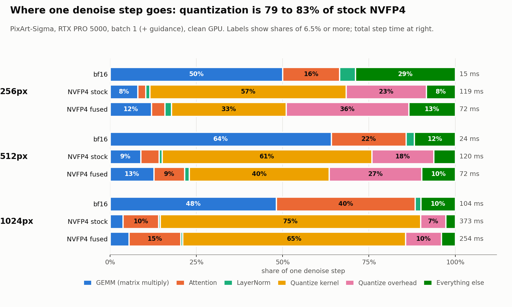
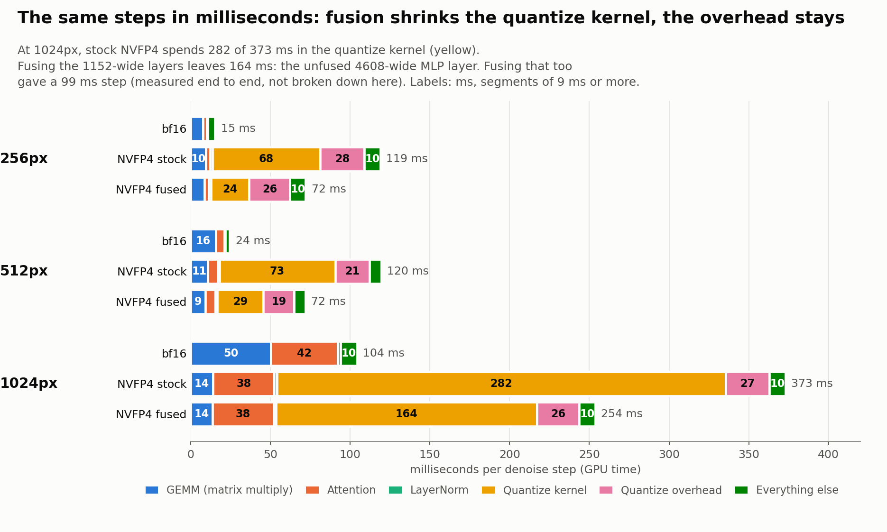

# Share of one denoise step (measured 2026-10-25, clean GPU)

| image | mode | step ms | GEMM (matrix multiply) | Attention | LayerNorm | Quantize kernel | Quantize overhead | Everything else |
|---|---|---|---|---|---|---|---|---|
| 256px | bf16 | 15.2 | 7.6 ms (50%) | 2.5 ms (16%) | 0.7 ms (5%) | 0.0 ms (0%) | 0.0 ms (0%) | 4.4 ms (29%) |
| 256px | NVFP4 stock | 118.9 | 9.5 ms (8%) | 2.8 ms (2%) | 1.4 ms (1%) | 67.6 ms (57%) | 27.6 ms (23%) | 10.0 ms (8%) |
| 256px | NVFP4 fused | 72.0 | 8.6 ms (12%) | 2.8 ms (4%) | 1.4 ms (2%) | 23.9 ms (33%) | 25.6 ms (36%) | 9.7 ms (13%) |
| 512px | bf16 | 24.5 | 15.7 ms (64%) | 5.3 ms (22%) | 0.6 ms (2%) | 0.0 ms (0%) | 0.0 ms (0%) | 2.9 ms (12%) |
| 512px | NVFP4 stock | 119.5 | 10.6 ms (9%) | 6.4 ms (5%) | 1.0 ms (1%) | 72.6 ms (61%) | 21.4 ms (18%) | 7.5 ms (6%) |
| 512px | NVFP4 fused | 71.9 | 9.1 ms (13%) | 6.4 ms (9%) | 1.0 ms (1%) | 29.1 ms (40%) | 19.3 ms (27%) | 7.0 ms (10%) |
| 1024px | bf16 | 104.3 | 50.2 ms (48%) | 42.0 ms (40%) | 1.7 ms (2%) | 0.0 ms (0%) | 0.0 ms (0%) | 10.4 ms (10%) |
| 1024px | NVFP4 stock | 373.0 | 14.0 ms (4%) | 38.4 ms (10%) | 1.6 ms (0%) | 281.5 ms (75%) | 27.3 ms (7%) | 10.2 ms (3%) |
| 1024px | NVFP4 fused | 253.7 | 13.8 ms (5%) | 38.1 ms (15%) | 1.5 ms (1%) | 163.7 ms (65%) | 26.5 ms (10%) | 10.1 ms (4%) |

Quantization = quantize kernel + quantize overhead. Source: `breakdown_step.py` (CUDA events); regenerate with `python3 make_figures.py`.
